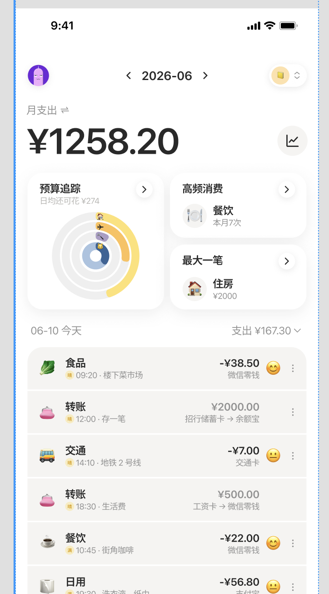
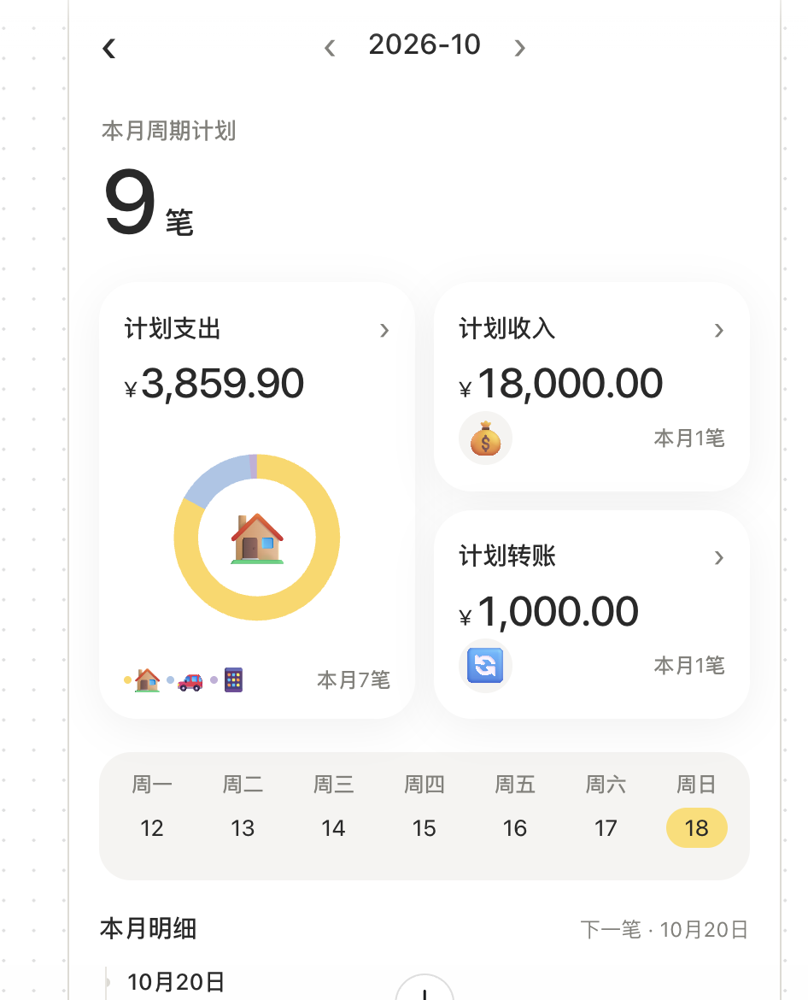
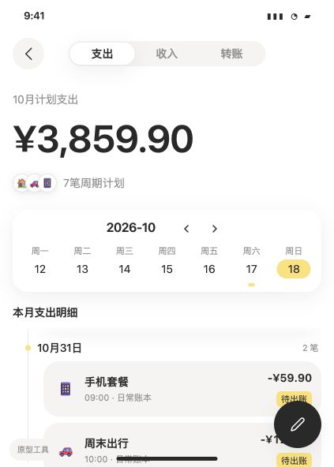
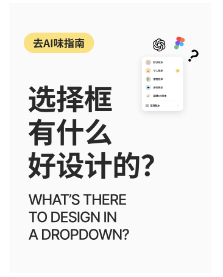

# 校准案例

这些是截图评审中的**参考判断**，没有用户实验或来源鉴定效力。任务未由使用者明确给出时，下列任务均为显式试评假设。参考分不是回归测试的精确目标；背景变化、修复或证据不同都可以调整，并说明理由。

先读索引与相近案例；需要核对视觉关系时，再打开对应图片。裁切标注仅辅助定位，不替代整图，也不用于推断精确像素。

| 编号 | 案例 | 当前参考 | 主要校准点 |
|---|---|---|---|
| C01 | 月支出首页，¥1258.20 | 约 2/10 | 有效同构、信息具体、居中导航可以成立 |
| C02 | 9 笔周期计划概览 | 约 4/10 | 业务结构成立，仍有跨图文的累积冗余 |
| C03 | 带周历的计划支出页，¥3859.90 | 约 4/10 | 对齐、卡内边距、外部缩进与视觉重心 |
| C04 | “这笔小奖励”偏好题 | 约 5/10 | 扩写负担、语义断行、按钮右偏；合理同构保留 |
| C05 | 两张“选择框有什么好设计的”封面 | 不作固定分数锚 | 双语与栏目目的未知，精致或粗糙不等于 AI 味 |

## C01：月支出首页

**任务假设：** 了解当月支出并浏览流水；范围为可见首屏，列表下方被截断。

**约 2/10，偏轻。**

成立的关系：

- 月支出金额突出，摘要和流水接续，层级可辨。
- “高频消费 → 餐饮 → 本月7次”与“最大一笔 → 住房 → ¥2000”采用相近读法：统计角度、对象、数值各有职责。
- 流水左侧对象及描述、右侧金额及账户保持稳定，主信息与灰色辅助信息的位置可复用。
- 图标与具体分类贴近，重复记录保持一致；密度和 emoji 不直接构成问题。
- 顶部月份与两侧切换箭头承担导航，居中不单独扣分。

局部检查：预算环图各圈的预算额度和进度需进一步说明（C）。截图不足以确认所有图表口径与交互。

**待判：** 月支出 ¥1258.20 小于“最大一笔 ¥2000”，需要统计口径、退款或净额背景。不能直接判数据错误，不能把未知默认为正确。天气、心情等记录是否服务产品目的，也需背景。

**可迁移判断：** 同构帮助复用阅读方式，而不只是卡片外观统一。

## C02：9 笔周期计划概览

**任务假设：** 了解本月周期计划的分类金额与后续安排；明细区域只展示开头。

**约 4/10，中等。**

成立的关系：总数 9 与支出7、收入1、转账1可对应；三类金额与“下一笔·10月20日”有实际信息价值。支出卡片与另外两卡尺寸有区别。9 是否应当最突出，取决于管理数量还是查看现金流，不预先扣分。

**主要问题 A：** “计划收入”下面的钱袋、“计划转账”下面的转账图标重复已经说清的类型，并各占独立底行；全页已有月份与“本月周期计划”，卡片又反复写“本月”。各元素单独能解释，组合后新增含义有限、扫描节点增加。

这条问题包含图标重复及其占位影响，只归 A，不再按“填卡片”“间距大”“抢注意”重复扣。修改可让金额与笔数更紧凑，必要图标贴近标题，保留分类笔数并按上下文压缩范围词。

**图表检查 C：** 图例只有颜色与表情，圆环按金额还是笔数、中央房子是最大项还是选中项，当前截图没有清楚交代。已见缺少口径说明；精确占比是否必需、交互能否补充，待背景判断。修改优先补足必要映射，不规定必须删除图表。

**可迁移判断：** 业务分类正确，不足以证明表达没有冗余；同形底行应检查其具体信息职责。

## C03：带周历的计划支出页

**任务假设：** 查看本月计划支出与待出账项目；范围为当前首屏，列表未完整展开。

**约 4/10，中等。** 最初只看表达与层级会得到偏轻判断；加入对齐、边距与视觉重量后，整页需重新定档，而非每个新增检查点自动加一分。

成立的关系：标题、金额、7笔数量、待出账状态各有贡献；金额重点清楚；周历七列中星期与日期的居中对应合理。

**月份标题的角色检查：** 支出说明、金额、数量和明细标题从左侧起读，日历把月份与切换箭头作为一组放在中部。在采用“月份作为内容卡片标题”的构成目标时，左侧内容线与右侧切换箭头是可讨论的方案；若承担独立月份导航，居中可以成立。未明确角色时先列待判，不把这里作为“月份必须左对齐”的扣分锚。

**C-02，卡片内部留白：** 标注区域中，图标到左侧边缘与金额/状态到右侧边缘的可见空隙不协调。先核对图标占位框，再以实际视觉外缘校正；时间线不能解释卡片内部的差异。

**C-03，外部缩进与偏右重心：** 时间线之后整列卡片再右缩，右侧接近页面边缘；重复底板形成偏右重量，右下深色按钮进一步加重同侧。检查缩进幅度与内外基准。缩进、外部留白与偏右按这一因果链记录，不拆成三次扣分。

**可独立记录的遮挡：** 当前截图中按钮遮住部分记录信息。若修好列表缩进仍然遮挡，可单列 C 并为按钮留出避让空间；它对右侧重量的影响已在前一条说明，不再次计入。记录粒度可按修复是否独立调整，不以凑齐问题数为目标。

**待判：** 选中18日与列表31日是否存在筛选冲突，需要交互；不能认定逻辑错误。工具标识或编辑状态不应自动当成产品文案。卡内边距、按钮遮挡可就当前可见效果讨论，不推断开发过程。

**背景变体：** 若明确月份行是独立导航、日期选择只作周历标记而不筛选下方全月列表，则解除月份角色与18/31日联动待判。内边距、外部缩进、重心和遮挡仍需检查。先前没有把待判项计入时，新背景不要求自动降分；也允许按影响重新给出有依据的相邻粗分。

**可迁移判断：** 有层级理由的缩进，仍可能在幅度和整组平衡上不妥；内部留白与外部缩进要分开观察。

## C04：“这笔小奖励”偏好题

**任务假设：** 读懂情境、选择消费或安排偏好、进入下一题。

**约 5/10，中等。**

**A，层层扩写：** 引题、问题、情境、选项标题与各段描述形成多个阅读层。“吃顿好的，再逛逛”后继续描述吃店、逛街和“把这一天填满”，新增区分条件较少；第二项也重复找地方慢慢读。保留“买本书”的消费条件和“没有明显偏向”的区别，可将新增含义合入标题再压缩复述。若测试目的需要这些情境措辞，删减幅度待判。

**C，标题断行：** “花？”单独落在末行，打断短句并形成不均匀的标题留白。可按语义断成“这笔小奖励，／你更想怎么花？”，不用改变字体风格来解释问题。

**C，按钮对齐与重心：** 卡片共享外部左侧起点，深色按钮右缘沿用卡片右缘，左缘额外内缩，整块重量偏右。先试与卡片同宽或其他明确的分组基准，再看整页；对齐与偏右记同一问题。

成立的关系：三组选项的图标、标题、正文、单选框位置稳定，属于合理同构；选中底色、描边与标记共同表达状态。题目、选项和下一步可辨，不能把全页说成没有重点。顶部购物袋的情绪与辨认作用不按装饰本身扣分。

**可迁移判断：** 缩短文案要保留新增条件；一致的选项结构与清楚的选中状态应保留。

## C05：两张选择框封面

**任务假设：** 面向中文观众，让人读懂内容主题并产生观看兴趣。

不设固定总分锚：第一张英文重复中文，但双语传播或品牌版式目的未给出；“去AI味指南”可能承担栏目辨认。第二张标志插入标题、跨行打断句子，关系需要澄清；“请看VCR”是否必要取决于静态封面还是视频开场。蓝色选框按编辑选中态辨认，不直接计入成稿。

第一张更精致、第二张更直接，都不足以推出整体 AI 味排序。只记录能解释的局部问题；来源信息不参与评分。

## 少量正例、反例与边界检查

| 场景 | 应有判断 |
|---|---|
| 彩色等大卡片用于比较同等重要的账户，标签清楚、数值对齐 | 等大和彩色可以成立，不按形式扣分。 |
| 极简页面只留抽象口号，关键按钮去向不清 | 可以有明显 A 问题，极简不获豁免。 |
| 有三笔未同步，新增一行状态和同步入口 | 信息增加可能改善理解，不因密度变高扣分。 |
| 同图仅换圆角或移除渐变，关系和可读性未变 | 不应自动降分。 |
| 同图从查看预算改为快速记账任务 | 重新判断 B，并检查真实入口，不直接反转所有结论。 |
| 只给一块卡片裁切，要求判断全页重心 | 只评局部留白；整页平衡待判。 |

这些例子用于检查规则边界，不要求强制产出指定整数。新页面出现无法覆盖的主观感受时，单记其证据缺口，留作下一轮校准。
